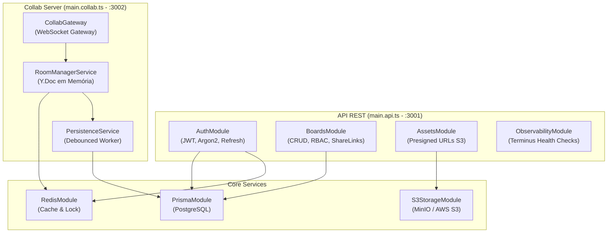

# 🚀 Whiteboard - Backend (API REST & Collab Server)

> Backend distribuído de alta escalabilidade construído com NestJS 11, Prisma 6, Yjs e Redis. Provê uma API REST stateless para gerenciamento de quadros, autenticação e presigned URLs S3, somada a um Collab Server WebSocket stateful dedicado à sincronização de salas em tempo real e reconciliação CRDT.

[](https://www.typescriptlang.org/)
[](https://nestjs.com/)
[](https://www.prisma.io/)
[](https://www.postgresql.org/)
[](https://redis.io/)
[](https://www.docker.com/)
[](https://vitest.dev/)

---

## 📋 Sobre o Projeto

O **Whiteboard Backend** é o núcleo de processamento e dados da solução de quadro branco colaborativo. Ele adota uma arquitetura de inicialização dupla (**dual-entrypoint**) em um único codebase:

1. **API REST Stateless (`main.api.ts`)**: Responsável pelo cadastro de usuários, autenticação segura, CRUD de quadros, permissões de membros (RBAC), links de compartilhamento e geração de presigned URLs para upload direto de mídias em storage S3.
2. **Collab Server Stateful (`main.collab.ts`)**: Servidor WebSocket dedicado que gerencia as conexões de tempo real por sala, troca mensagens binárias compactadas através do protocolo Yjs (`y-protocols` + `lib0`), propaga a presença dos usuários e persiste deltas e snapshots binários de forma assíncrona.

Esta separação garante que o consumo intensivo de I/O em tempo real do WebSocket não degrade o desempenho ou a disponibilidade das rotas REST de gerenciamento.

---

## 🌐 Serviços e Portas Locais

| Serviço           | Porta / URL                                                              | Descrição                                              |
| :---------------- | :----------------------------------------------------------------------- | :----------------------------------------------------- |
| **API REST**      | [http://localhost:3001](http://localhost:3001)                           | Ponto de entrada das requisições HTTP REST             |
| **Swagger UI**    | [http://localhost:3001/v1/docs](http://localhost:3001/v1/docs)           | Documentação interativa dos endpoints                  |
| **OpenAPI Spec**  | [http://localhost:3001/v1/docs-json](http://localhost:3001/v1/docs-json) | Especificação OpenAPI para geração do cliente frontend |
| **Collab Server** | `ws://localhost:3002`                                                    | Gateway WebSocket para sincronização Yjs               |
| **Health Checks** | [http://localhost:3001/health/live](http://localhost:3001/health/live)   | Sondagem de liveness e readiness                       |

---

## 🧱 Arquitetura dos Módulos



---

## 🤝 Contrato com o Frontend (Fonte da Verdade)

Este repositório é a **fonte oficial da verdade** de todo o contrato compartilhado com o frontend. Todos os arquivos em `src/shared/` definem o schema de dados, versões de compatibilidade e constantes de rede.

### Regras de Ouro ao Alterar o Contrato:

1. **Edição do Schema/Protocolo**: Modifique os arquivos em `src/shared/` (`schema.ts`, `protocol.ts`, `version.ts`).
2. **Atualização da Versão**: Se houver quebra de retrocompatibilidade, incremente `SCHEMA_VERSION` ou `PROTOCOL_VERSION` em `src/shared/version.ts`.
3. **Regeneração de Fixtures**: Execute o script de regeneração para atualizar os testes contratuais:
   ```bash
   npx tsx scripts/gen-fixtures.ts
   npm test
   ```
4. **Sincronização no Frontend**: No repositório frontend, execute `npm run sync:shared` para importar a nova versão do contrato.

---

## 🚀 Início Rápido

### Pré-requisitos

- [Node.js](https://nodejs.org/) 22 ou superior
- [npm](https://www.npmjs.com/) 10 ou superior
- Instâncias do PostgreSQL, Redis e MinIO ativas (recomendado via `make deps` na raiz do projeto)

### Instalação e Configuração

1. **Clone e acesse a pasta do backend**

   ```bash
   cd backend
   ```

2. **Instale as dependências**

   ```bash
   npm ci
   ```

3. **Configure as variáveis de ambiente**

   ```bash
   cp .env.example .env
   ```

4. **Execute as migrações do banco de dados**

   ```bash
   npx prisma migrate dev
   ```

5. **(Opcional) Popule o banco com dados iniciais de teste**

   ```bash
   npm run db:seed
   ```

6. **Inicie os dois serviços em terminais separados**

   _Terminal 1 (API REST):_

   ```bash
   npm run start:api:dev
   ```

   _Terminal 2 (Collab Server WebSocket):_

   ```bash
   npm run start:collab:dev
   ```

7. **Acesse a documentação interativa**
   Abra no navegador: [http://localhost:3001/v1/docs](http://localhost:3001/v1/docs)

---

## 📦 Estrutura do Projeto

```text
backend/
├── prisma/
│   ├── schema.prisma              # Definição do schema relacional (User, Board, Snapshot, etc.)
│   ├── migrations/                # Histórico cronológico de migrações SQL
│   └── seed.ts                    # Script de população do banco para desenvolvimento
│
├── src/
│   ├── core/                      # Módulos de infraestrutura e serviços globais
│   │   ├── config/                # Validação de variáveis de ambiente com Zod
│   │   ├── database/              # PrismaService e controle de ciclo de vida
│   │   ├── observability/         # Health checks (Terminus) e métricas
│   │   ├── redis/                 # Cliente Redis (ioredis) e chaves padronizadas
│   │   └── storage/               # Cliente S3 (AWS SDK v3) e presigned URLs
│   │
│   ├── common/                    # Utilitários compartilhados no framework
│   │   ├── decorators/            # @CurrentUser, @CurrentBoardAccess, @BoardRoles
│   │   ├── filters/               # GlobalExceptionFilter com formato padronizado de erro
│   │   ├── guards/                # JwtAuthGuard, BoardAccessGuard
│   │   ├── interceptors/          # LoggingInterceptor para tempo de resposta
│   │   └── middlewares/           # RequestContext, CorrelationID e Headers de segurança
│   │
│   ├── modules/                   # Módulos de negócio da aplicação
│   │   ├── assets/                # Geração de URLs pré-assinadas para uploads
│   │   ├── auth/                  # Registro, login, refresh tokens e lockout
│   │   ├── boards/                # CRUD de quadros, membros, ACL e share links
│   │   ├── collab/                # CollabGateway WS, RoomManager, decodificação lib0
│   │   ├── persistence/           # PersistenceService (gravação em lote de deltas e snapshots)
│   │   └── users/                 # Repositório de usuários
│   │
│   ├── shared/                    # FONTE DA VERDADE do contrato compartilhado
│   │   ├── protocol.ts            # Tipos de mensagens WS e constantes de rede
│   │   ├── schema.ts              # Schemas Zod dos elementos do canvas e awareness
│   │   └── version.ts             # Constantes SHARED_VERSION, SCHEMA_VERSION, PROTOCOL_VERSION
│   │
│   ├── main.api.ts                # Bootstrap da API REST (porta 3001)
│   ├── main.collab.ts             # Bootstrap do WebSocket Server (porta 3002)
│   ├── app.module.ts              # Módulo raiz da API
│   └── collab.module.ts           # Módulo raiz do Collab Server
│
├── docker/
│   └── Dockerfile                 # Dockerfile multi-stage (targets: api e collab)
├── test/                          # Testes de integração com Testcontainers
├── package.json
└── tsconfig.json
```

---

## 🔧 Configuração de Ambiente

As configurações são validadas na inicialização via schema Zod (`src/core/config/env.ts`):

```env
NODE_ENV=development
API_PORT=3001
COLLAB_PORT=3002

# PostgreSQL
DATABASE_URL=postgresql://wb:wb@localhost:5442/whiteboard

# Redis
REDIS_URL=redis://localhost:6379

# Autenticação & JWT
JWT_ACCESS_SECRET=change-me-with-at-least-32-characters-please
JWT_ACCESS_TTL=900
REFRESH_COOKIE_NAME=wb_refresh
WS_TICKET_TTL=30
ALLOWED_ORIGINS=http://localhost:3000

# Armazenamento MinIO / S3
S3_ENDPOINT=http://localhost:9000
S3_BUCKET=whiteboard-assets
S3_ACCESS_KEY=minio
S3_SECRET_KEY=minio12345
S3_REGION=us-east-1
```

| Variável            | Padrão              | Descrição                                                       |
| :------------------ | :------------------ | :-------------------------------------------------------------- |
| `API_PORT`          | `3001`              | Porta de escuta da API REST                                     |
| `COLLAB_PORT`       | `3002`              | Porta de escuta do WebSocket Collab Server                      |
| `DATABASE_URL`      | -                   | String de conexão completa com o PostgreSQL                     |
| `REDIS_URL`         | -                   | URL do servidor Redis para cache e gerenciamento de salas       |
| `JWT_ACCESS_SECRET` | -                   | Chave secreta de no mínimo 32 caracteres para assinatura do JWT |
| `JWT_ACCESS_TTL`    | `900`               | Duração do token de acesso em segundos (15 minutos)             |
| `WS_TICKET_TTL`     | `30`                | Tempo de vida em segundos do ticket temporário para o WebSocket |
| `S3_ENDPOINT`       | -                   | URL do servidor S3/MinIO para presigned URLs                    |
| `S3_BUCKET`         | `whiteboard-assets` | Nome do bucket destinado a imagens e anexos                     |

---

## 📝 Scripts Disponíveis

```bash
# Desenvolvimento
npm run start:api:dev       # Inicia a API REST com recarregamento automático (watch)
npm run start:collab:dev    # Inicia o servidor Collab com recarregamento automático

# Build e Produção
npm run build               # Compila os bundles em dist/ (main.api.js e main.collab.js)

# Banco de Dados & Prisma
npm run prisma:generate     # Gera o Prisma Client tipado
npm run prisma:migrate      # Cria e aplica migrações em ambiente de desenvolvimento
npm run prisma:deploy       # Aplica migrações pendentes em produção
npm run db:seed             # Executa o seed com dados de demonstração

# Qualidade de Código & Testes
npm run check               # Executa o Biome em modo verificação (linter + formatação)
npm run check:fix           # Aplica correções seguras automaticamente com Biome
npm run format:biome        # Formata os arquivos do projeto com Biome
npm run lint                # Executa o linter ESLint em todo o projeto
npm run format              # Formata arquivos com Prettier
npm run typecheck           # Valida tipos com TypeScript compiler sem emitir JS
npm run test                # Roda a suíte de testes unitários e de contrato com Vitest
npm run test:int            # Roda os testes de integração com Testcontainers

# Contrato
npx tsx scripts/gen-fixtures.ts # Atualiza fixtures binárias do protocolo Yjs
```

---

## 🐳 Construção com Docker

O arquivo `docker/Dockerfile` utiliza multi-stage builds otimizados com `node:22-alpine` para gerar imagens de produção leves e seguras:

```bash
# Gerar imagem da API REST
docker build -f docker/Dockerfile --target api -t wb-api .

# Gerar imagem do Collab Server
docker build -f docker/Dockerfile --target collab -t wb-collab .
```
