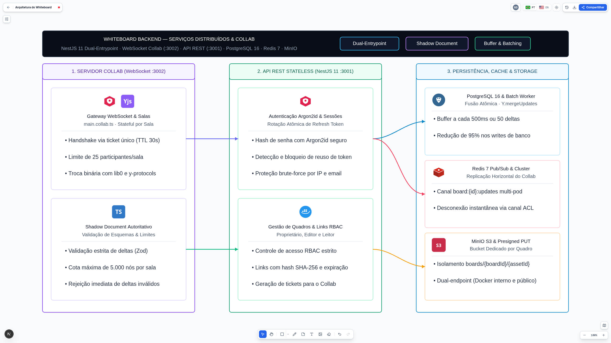
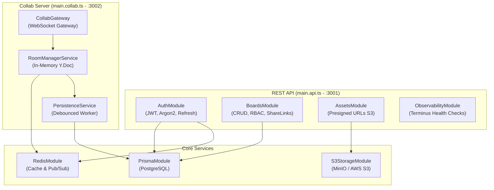

# 🚀 Whiteboard — Backend (REST API & Collab Server)

> High-scalability distributed backend built with NestJS 11, Prisma 6, Yjs, and Redis. Features a stateless REST API for user management, authentication, and S3 presigned URLs, paired with a stateful WebSocket Collab Server dedicated to real-time room synchronization, authoritative Shadow Document validation, and CRDT persistence.

[](https://www.typescriptlang.org/)
[](https://nestjs.com/)
[](https://www.prisma.io/)
[](https://www.postgresql.org/)
[](https://redis.io/)
[](https://www.docker.com/)
[](https://vitest.dev/)

---

<div align="center">
  
  <p><em>Dual-entrypoint architecture (REST API :3001 & Collab WS :3002), authoritative Shadow Document, and distributed persistence</em></p>
</div>

---

## 📋 About The Submodule

The **Whiteboard Backend** is the core processing and persistence engine of the platform. It adopts a **dual-entrypoint architecture** within a single codebase:

1. **Stateless REST API (`main.api.ts` on port 3001)**: Handles user registration, Argon2id authentication, board CRUD, RBAC member management (`OWNER`, `EDITOR`, `VIEWER`), share links with SHA-256 tokens, and presigned S3 URLs for direct client media uploads.
2. **Stateful Collab Server (`main.collab.ts` on port 3002)**: Dedicated WebSocket gateway managing real-time connections per board room, binary Yjs delta exchange (`y-protocols` + `lib0`), live user presence, authoritative Shadow Document schema validation, and debounced snapshot persistence.

This strict separation ensures that real-time WebSocket I/O does not degrade the performance or availability of management REST endpoints.

---

## 🌐 Local Services & Endpoints

| Service | Address | Description |
| :--- | :--- | :--- |
| **REST API** | [http://localhost:3001](http://localhost:3001) | HTTP REST endpoints (`/v1/*`) |
| **Swagger UI** | [http://localhost:3001/v1/docs](http://localhost:3001/v1/docs) | Interactive OpenAPI documentation |
| **OpenAPI Spec** | [http://localhost:3001/v1/docs-json](http://localhost:3001/v1/docs-json) | OpenAPI JSON specification |
| **Collab Server** | `ws://localhost:3002/collab` | Real-time WebSocket CRDT gateway |
| **Health Liveness** | [http://localhost:3001/health/live](http://localhost:3001/health/live) | Basic HTTP liveness probe |
| **Health Readiness** | [http://localhost:3001/health/ready](http://localhost:3001/health/ready) | PostgreSQL and Redis readiness probe |

---

## 🧱 Module Architecture



---

## 🤝 Contract Authority (Single Source of Truth)

This repository is the **authoritative single source of truth** for all shared data contracts. All files in `src/shared/` define the data schemas, protocol constants, and version numbers.

### Rules for Contract Modifications:
1. **Edit Schemas/Protocols**: Make all modifications in `src/shared/` (`schema.ts`, `protocol.ts`, `version.ts`).
2. **Update Version**: If breaking backwards compatibility, increment `SCHEMA_VERSION` or `PROTOCOL_VERSION` in `src/shared/version.ts`.
3. **Regenerate Fixtures**: Update binary protocol fixtures:
   ```bash
   npx tsx scripts/gen-fixtures.ts
   npm test
   ```
4. **Propagate to Frontend**: Run `make sync-shared` from the workspace root (or `npm run sync:shared` in the frontend).

---

## 🚀 Quickstart

### Prerequisites
- [Node.js](https://nodejs.org/) `20.x` or `22.x`
- [npm](https://www.npmjs.com/) `10.x+`
- PostgreSQL, Redis, and MinIO running (recommended via `make deps` at workspace root)

### Installation & Execution
```bash
# 1. Install dependencies
npm ci

# 2. Copy environment configuration
cp .env.example .env

# 3. Apply database migrations
npm run prisma:migrate

# 4. (Optional) Seed demo users and boards
npm run db:seed

# 5. Start development servers
# Terminal 1: REST API
npm run start:api:dev

# Terminal 2: Collab Server
npm run start:collab:dev
```

---

## 📝 Available Scripts

```bash
# Development
npm run start:api:dev       # Starts REST API with auto-reload (port 3001)
npm run start:collab:dev    # Starts Collab Server with auto-reload (port 3002)

# Production Build
npm run build               # Compiles dist/ bundles for both entrypoints

# Database & Migrations
npm run prisma:generate     # Generates typed Prisma Client
npm run prisma:migrate      # Applies development migrations
npm run prisma:deploy       # Applies production migrations
npm run db:seed             # Seeds development database

# Quality & Testing
npm run lint                # Runs ESLint analysis
npm run format              # Formats code with Prettier
npm run typecheck           # Runs strict TypeScript validation (tsc --noEmit)
npm run test                # Runs Vitest unit & contract tests (71 tests)
npm run test:int            # Runs integration tests with Testcontainers (Docker required)
```

---

## 🐳 Docker Deployment

The `docker/Dockerfile` uses multi-stage builds optimized with `node:22-alpine` for lightweight and secure production images:

```bash
# Build REST API image
docker build -f docker/Dockerfile --target api -t wb-api .

# Build Collab Server image
docker build -f docker/Dockerfile --target collab -t wb-collab .
```

---

## 📚 Technical Documentation & Agent Guides

- **Backend Agent Guidelines**: [`AGENTS.md`](./AGENTS.md) · [`CLAUDE.md`](./CLAUDE.md)
- **Local Development Guide**: [`../docs/DEVELOPMENT.md`](../docs/DEVELOPMENT.md)
- **Testing Handbook**: [`../docs/TESTING.md`](../docs/TESTING.md)
- **CRDT & Collab Protocol**: [`../docs/PROTOCOL.md`](../docs/PROTOCOL.md)
- **System Architecture**: [`../docs/architecture.md`](../docs/architecture.md)
- **ADR-006 (Dual-Entrypoint)**: [`../docs/adr/ADR-006-dual-entrypoint-nestjs.md`](../docs/adr/ADR-006-dual-entrypoint-nestjs.md)
